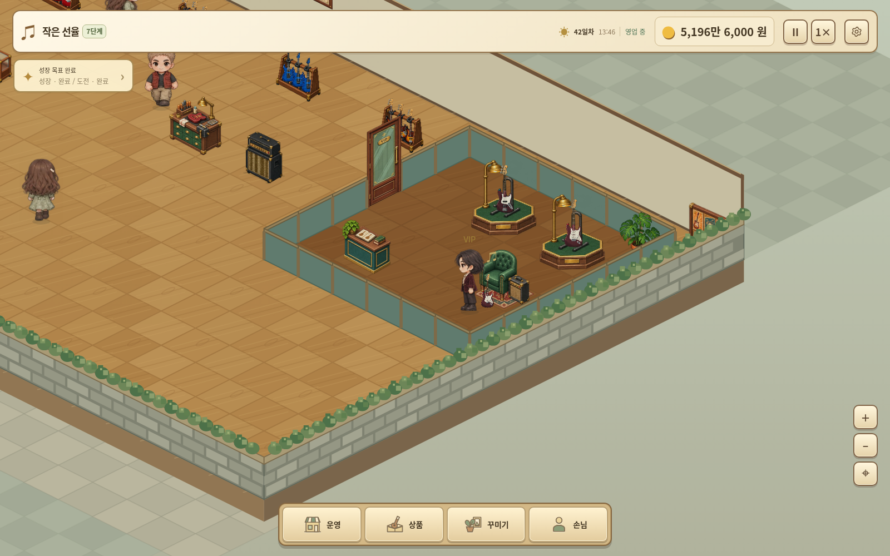

# 작은 선율 v3.18.0

[게임 ZIP 다운로드](https://github.com/dkmoon26-cmyk/test/raw/refs/heads/downloads/little-tone-v3.18.0/little-tone-v3.18.0-web.zip)

원하는 위치의 VIP 구역, 신규 VIP 3명, 커스텀 제작대, 벽지·바닥·벽 장식을 추가했습니다.

- VIP 구역과 필수 가구가 준비되면 하루 최대 1명 별도 방문.
- 제작대 3등급 업그레이드, 기본 악기 재고 1개로 커스텀, 특별 전시대에 진열해 VIP에게 판매.
- 제작·진열에는 기존 악기 원본 이미지 사용. 회전은 기존 2D 앞·뒷면 기반 미리보기.
- 벽 장식·문·신규 가구 전용 이미지, 소품 바닥 각도와 네 방향 정렬 보정.
- 예약 악기 자동 주문 기본 기준 1개 / 수량 1개. 기존 수동 설정 유지.

## 실제 게임 화면

[전체 매장](./ui-v3.18.0-game.png) · [커스텀 제작 화면](./ui-v3.18.0-workshop.png) · [모바일 제작 화면](./ui-v3.18.0-workshop-mobile.png) · [신규 VIP 3명](./ui-v3.18.0-vip-people.png) · [인테리어 편집](./ui-v3.18.0-interior.png) · [소품 네 방향 비교](./ui-v3.18.0-directions.png)

## 검증과 실행

신규 기능 61항목, 기존 회귀 검사 54항목, 기존 운영 99일과 VIP 거래 13일을 확인했습니다. VIP/후반 기능은 자금과 미션 실적을 설정한 매장에서 검사했습니다.

[패치 내용·검증 범위](./PATCH-v3.18.0.md) · [검증 결과](./VALIDATION-v3.18.0.json)

기존 v3.17 저장 가져오기를 확인했습니다. 저장 스키마 22이며 새 저장은 이전 버전에서 열 수 없습니다.
ZIP을 풀어 정적 웹 호스팅에 폴더 내용을 올리면 실행할 수 있습니다. 버전별 저장을 옮길 때는 기존 게임의 저장 관리에서 파일이나 코드를 백업해 새 버전으로 불러오세요.
