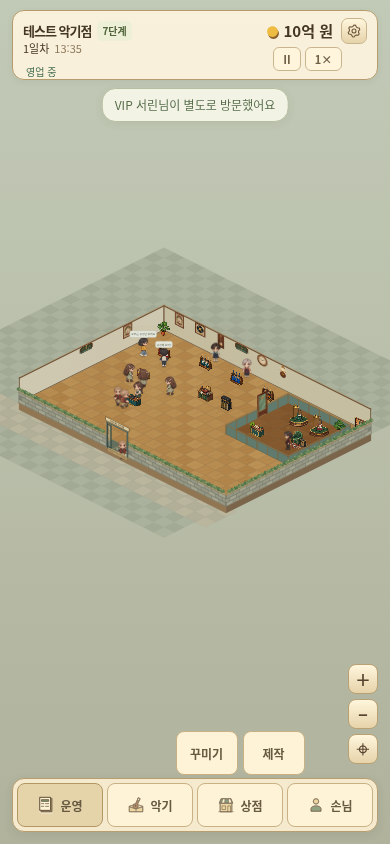

# 작은 선율 v3.19.0

**[일반 게임 ZIP 다운로드](https://github.com/dkmoon26-cmyk/test/raw/refs/heads/downloads/little-tone-v3.19.0/little-tone-v3.19.0-web.zip)**

**[7단계 · 10억 원 테스트판 다운로드](https://github.com/dkmoon26-cmyk/test/raw/refs/heads/downloads/little-tone-v3.19.0/little-tone-v3.19.0-test-stage7-1b.zip)**

- 운영·악기·상점·손님: 버튼 위에 하위 메뉴가 가로 한 줄로 펼쳐집니다. 제목과 바깥 배경 제거.
- 낮은 상단, 짧은 금액 표기, 작은 3초 알림, 크기·테두리를 통일한 하단 버튼.
- 요청·광고 기능 제거, 운영의 VIP 공방 영역 제거, VIP 목록은 VIP 메뉴에서만 표시.
- 커스텀 색상·목재·픽업·금속 부품·마감 실시간 반영. 완성품·전시대·저장 후 같은 외형 유지.
- 기본 벽은 빈 상태. 공연 포스터·레코드·벽걸이 기타·가게 간판·시계·벽등 6종 직접 설치.

## 실제 패치 화면

[실시간 커스텀](./ui-v3.19.0-workshop.png) · [제작 관리](./ui-v3.19.0-craft-mobile.png) · [VIP 메뉴](./ui-v3.19.0-vip-mobile.png) · [운영](./ui-v3.19.0-operations-mobile.png) · [벽 장식이 설치된 매장](./ui-v3.19.0-game.png)

## 실행과 검증

ZIP을 풀어 정적 웹 호스팅에 폴더 내용을 올리면 실행할 수 있습니다. 테스트판은 타이틀에서 이어하기를 누르면 7단계·10억 원으로 시작하며, 새로 시작해도 같은 초기 조건으로 돌아갑니다. 일반판과 테스트판의 자동 저장 공간은 분리했습니다.

이미 일반 v3.19를 실행 중이라면 [테스트 저장 파일](./test-save-stage7-1b-v3.19.0.json)을 저장 관리에서 직접 불러올 수도 있습니다.

신규 검사 42항목, 기존 제작·저장 검사 61항목, 기존 회귀 54항목, 기존 운영 99일·VIP 거래 13일을 확인했습니다. 기타·베이스 옵션 28가지와 원본 악기 12종·앞뒷면 24개 변경을 검증했습니다. 후반과 VIP는 테스트 매장으로 검사했습니다.

[전체 패치 내용·검증 범위](./PATCH-v3.19.0.md) · [검증 결과](./VALIDATION-v3.19.0.json)

저장 스키마 23. 기존 v3.17·v3.18 저장을 가져올 수 있으며, 새 저장은 이전 버전에서 지원하지 않습니다. 기존 버전의 저장 관리에서 먼저 백업하세요.
