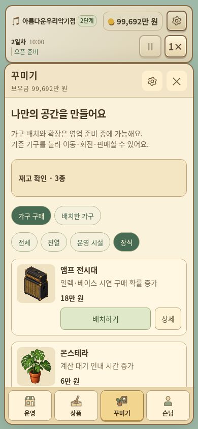

# 작은 선율 v3.17.0

[게임 ZIP 다운로드](https://github.com/dkmoon26-cmyk/test/raw/refs/heads/downloads/little-tone-v3.17.0/little-tone-v3.17.0-web.zip)

- 예약 악기는 준비 중 주문 시 오늘15시, 영업 중 주문 시 내일 오픈 전 입고. 긴급주문은 즉시 입고.
- 운영·상품·꾸미기·손님 네 메뉴, 방문 중/단골/요청/이야기 탭.
- 꾸미기 카드의 배경·이미지·배치 통일, 한 줄 설명과 상세 창.
- 직접 진행하는 첫 영업7단계 튜토리얼, 읽을 때 일시정지, 건너뛰기·재접속·다시 보기.
- 저장 관리 통합과 불러오기 적용 전 확인.
- 진열대 위 이름·품절 글자 숨김, 눌러서 이름·재고 확인. 상단 가게 이름 옆 단계 배지.
- 완료 요청 본문과 이전 요청 목록 제거, 손님별 완료 횟수 유지.
- 한글 글꼴 포함 및 글자 크기 정리. 운영 기록의 누적 판매 두 항목 제거.
- 첫 재고 알바 이후 기본 상품 알림 숨김과10일 운영비 보호 등 기존 정책 유지.

## 실제 화면

[장식 상세](./ui-v3.17.0-decor-detail.png) · [손님 메뉴](./ui-v3.17.0-guests-mobile.png) · [저장 관리](./ui-v3.17.0-save-mobile.png) · [첫 영업 튜토리얼](./ui-v3.17.0-tutorial-mobile.png) · [상품 구매](./ui-v3.17.0-stock-mobile.png)

## 검증과 실행

99일 영업·판매2,533건·저장 왕복132회, 신규 통합 검사34개·기존 회귀 검사54개·알림 정책10개 시나리오를 통과했습니다. 후반 및 경계 조건은 테스트 데이터를 사용했습니다.

[패치 내용과 검증 범위](./PATCH-v3.17.0.md) · [검증 요약](./VALIDATION-v3.17.0.json)

v3.13~v3.16 저장 가져오기 확인. 저장 스키마21이며 새 저장은 이전 버전에서 열 수 없습니다.
ZIP을 풀어 정적 웹 호스팅에 폴더 내용을 올리면 실행할 수 있습니다.
배포 파일별 체크섬은 ZIP의 DEPLOY-MANIFEST.json, ZIP 체크섬은 SHA256SUMS에서 확인할 수 있습니다.
