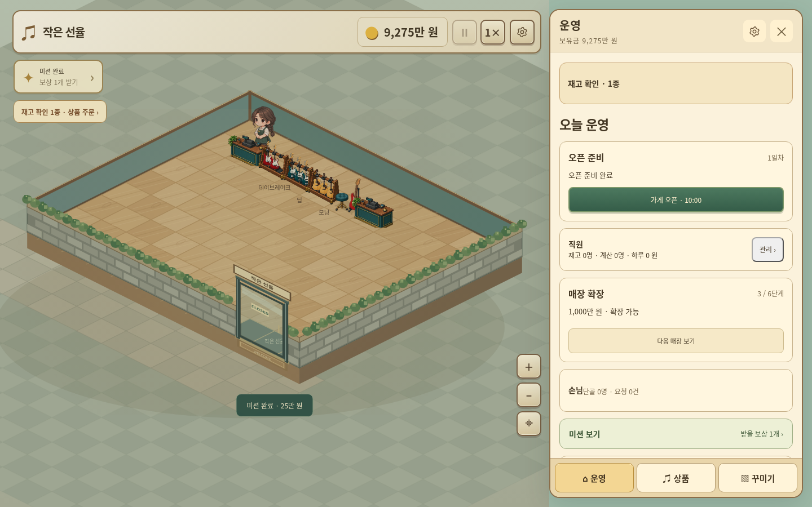

# 작은 선율 v3.14.0

[게임 ZIP 다운로드](https://github.com/dkmoon26-cmyk/test/raw/refs/heads/downloads/little-tone-v3.14.0/little-tone-v3.14.0-web.zip)

- 꾸미기 이미지 잘림 수정, 수량 선택을 구매 버튼 위로 이동.
- 일시정지·시작과 배속을 상단에 복원.
- 운영 메뉴 축약, 미션 전용 창과 진행 중/완료 탭.
- 직원 역할·상태·채용·주문 설정을 정리하고 퇴사 확인 추가.
- 부족 알림 2개 이하, 자동 주문 추천 기준 3개 이하.
- 수동 최소 보유금 설정을 없애고 자동 주문 시 10일분 임대료와 전체 직원 일급 확보. 입고 예정 상품 중복 주문 방지.
- 이전 버전 장식 효과와 캐릭터 이동 유지.

## 실제 화면

[직원 관리](./ui-v3.14.0-staff.png) · [미션](./ui-v3.14.0-missions.png) · [모바일 상품 구매](./ui-v3.14.0-stock.png)

## 검증과 실행

99일 영업·저장 왕복 132회, 자동 주문 경계값·미션 보상·모바일 배치·기존 장식 효과 검사 통과. 후반은 자금과 실적을 주입한 기능 검사입니다.

[변경 사항·조건·검증 범위](./PATCH-v3.14.0.md)

ZIP을 풀어 정적 웹 호스팅에 폴더 내용을 올리면 실행할 수 있습니다.
v3.13.0 저장 가져오기 검증 완료. 새 저장 스키마는 20이며 이전 버전에서 열 수 없습니다.
SHA-256 체크섬은 SHA256SUMS 파일에서 확인할 수 있습니다.
