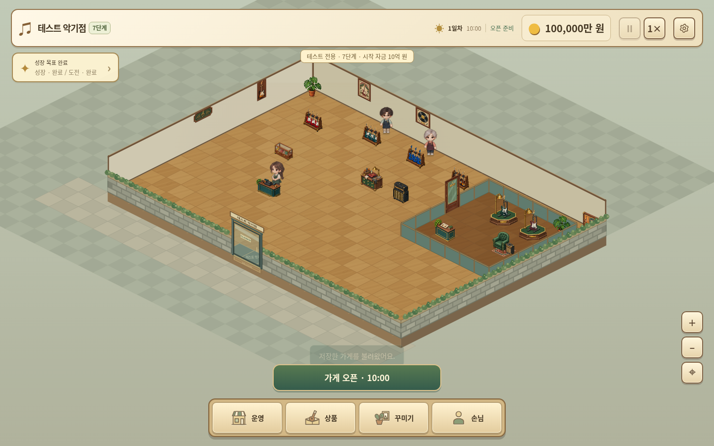

# 작은 선율 v3.18.0 · 7단계 / 10억 테스트판

[테스트 게임 ZIP 다운로드](https://github.com/dkmoon26-cmyk/test/raw/refs/heads/downloads/little-tone-v3.18.0-test/little-tone-v3.18.0-test-stage7-1b.zip)

타이틀에서 **이어하기**를 누르면 다음 상태로 시작합니다.

- 매장 7단계, 현금 정확히 1,000,000,000원(10억 원).
- VIP 구역·내부 문·특별 전시대·VIP 시연석·상담 테이블 배치 완료.
- 커스텀 제작대 1등급, 완성 악기 2개 진열, 상품 재고 각 20개.
- 제작대 업그레이드는 직접 시험 가능. 오픈하면 VIP가 별도로 방문.
- 기존 일반판과 자동 저장 공간 분리. 테스트 진행 내용은 재접속 시 유지.
- 타이틀에서 새로 시작하면 7단계·10억 원의 초기 테스트 조건으로 되돌아감.

ZIP을 풀어 정적 웹 호스팅에 폴더 내용을 올려 실행하세요. 게임과 테스트 초기 상태가 모두 포함되어 있습니다.

기존 v3.18 게임에서 테스트하려면 [테스트 저장 파일](https://github.com/dkmoon26-cmyk/test/raw/refs/heads/downloads/little-tone-v3.18.0-test/test-save-stage7-1b.json)을 저장 관리에서 직접 불러올 수도 있습니다.

브라우저에서 초기 현금·7단계·VIP 운영 가능 상태, 제작대 1→3등급, 제작·VIP 구매·마감·다음날, 재접속 후 진행 유지, 새로 시작 시 테스트 조건 초기화, 일반판 저장 보존을 확인했습니다. [검증 결과](./TEST-v3.18.0-stage7.json)

[일반 v3.18.0 버전](https://github.com/dkmoon26-cmyk/test/tree/downloads/little-tone-v3.18.0)
