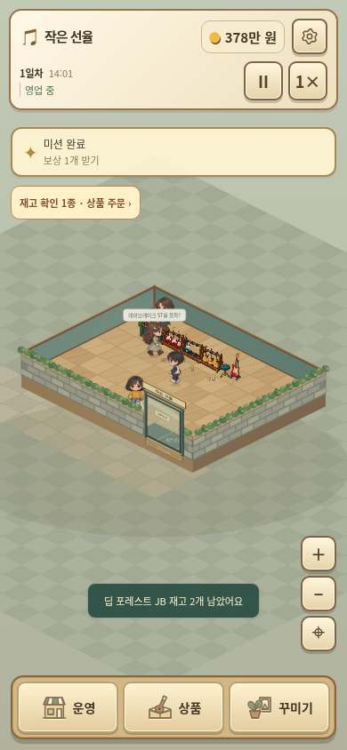

# 작은 선율 v3.15.0

[게임 ZIP 다운로드](https://github.com/dkmoon26-cmyk/test/raw/refs/heads/downloads/little-tone-v3.15.0/little-tone-v3.15.0-web.zip)

- 마지막 악기 진열대 판매로 진행이 막히는 상황 방지.
- 메뉴를 열어도 외부 일시정지/시작·배속 조작 가능.
- 모바일 날짜·시간 정리, 운영 수치 실시간 갱신, 다음 미션 안내 표시.
- 직원이 보충할 수 있는 상품의 재고 알림 숨김. 미담당·자동 주문 꺼짐·자금 부족이면 표시.
- 입문 상품은 재고 3개 이하에 5개, 예약 악기는 3개 이하에 1개 주문. 상품별 수동 설정·긴급주문·10일 운영비 보호 유지.
- 하단 메뉴를 악기점·기타 상품 상자·화분/액자 SVG 아이콘으로 통일.

## 실제 게임 화면

[PC 운영 화면](./ui-v3.15.0-operations.png) · [상품 구매](./ui-v3.15.0-stock.png) · [직원 관리](./ui-v3.15.0-staff.png) · [미션](./ui-v3.15.0-missions.png)

## 검증과 실행

99일 영업·저장 왕복 132회, 신규 회귀 검사 54개와 8가지 화면 크기 검사를 통과했습니다. 후반 영업은 자금/실적을 주입한 기능 검사입니다.

[패치 내용과 검증 범위](./PATCH-v3.15.0.md) · [검증 요약 데이터](./VALIDATION-v3.15.0.json)

v3.13.0/v3.14.0 저장 가져오기 및 영업 중 새로고침 복구를 확인했습니다. 저장 스키마 20 유지.
ZIP을 풀어 정적 웹 호스팅에 폴더 내용을 올리면 실행할 수 있습니다.
배포 파일별 체크섬은 ZIP의 DEPLOY-MANIFEST.json, ZIP 체크섬은 SHA256SUMS에서 확인할 수 있습니다.
