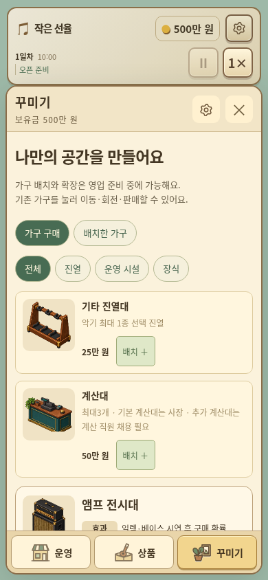

# 작은 선율 v3.16.0

[게임 ZIP 다운로드](https://github.com/dkmoon26-cmyk/test/raw/refs/heads/downloads/little-tone-v3.16.0/little-tone-v3.16.0-web.zip)

- 첫 재고 알바 고용 후 기본 악기·소모품의 재고 알림을 완전히 숨깁니다. 자동 주문 꺼짐이나 자금 부족이어도 숨깁니다.
- 왼쪽 재고 알림, 운영/꾸미기 재고 목록, 재고 2개/품절 짧은 알림에 적용합니다. 예약 악기는 기존 조건을 유지합니다.
- 설정 변경 및 직원 보충 후 이전 알림이 남는 문제를 수정했습니다.
- 꾸미기 11종의 미리보기 칸과 여백을 통일하고 그림 비율을 유지해 확대했습니다.
- 기존 주문량·수동 설정·긴급주문·10일 운영비 보호는 유지합니다.

## 실제 화면

[PC 꾸미기](./ui-v3.16.0-decor-desktop.png) · [카탈로그 미리보기](./ui-v3.16.0-catalog.png)

## 검증

99일 영업·판매 2,515건·저장 왕복 132회, 회귀 검사 54개와 알림 정책 시나리오 10개, PC/모바일 미리보기 22개 검사를 통과했습니다. 후반 영업과 일부 경계 조건은 테스트 데이터를 사용했습니다.

[변경 내용과 검증 범위](./PATCH-v3.16.0.md) · [검증 요약](./VALIDATION-v3.16.0.json)

v3.13.0/v3.14.0/v3.15.0 저장 가져오기 및 영업 중 새로고침 복구 확인. 저장 스키마20 유지.
ZIP을 풀어 정적 웹 호스팅에 폴더 내용을 올리면 실행할 수 있습니다.
배포 파일별 체크섬은 ZIP의 DEPLOY-MANIFEST.json, ZIP 체크섬은 SHA256SUMS에서 확인할 수 있습니다.
