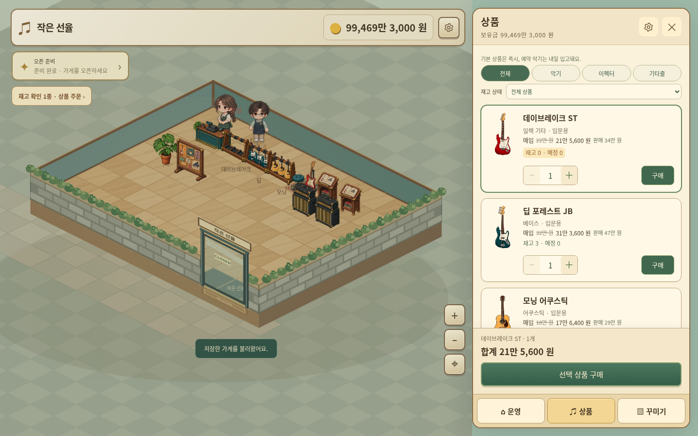
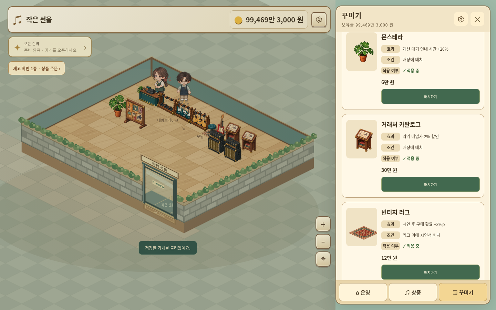

# 작은 선율 v3.13.0

[게임 ZIP 다운로드](./little-tone-v3.13.0-web.zip?raw=true)

시안의 UI 구조와 장식 효과를 적용한 실제 게임입니다.

- 운영·상품·꾸미기 메뉴, 간결한 상단 정보, 설정/기록 톱니바퀴.
- 상품 재고·입고·수량·가격 카드와 하단 구매 버튼. PC 오른쪽 패널, 모바일 아래 패널.
- 가구 이동·회전·판매·상세 빠른 조작.
- 거래처 카탈로그: 악기 매입가 2% 할인.
- 빈티지 러그: 러그 위 악기 시연석의 시연 후 구매 확률 +3%p.
- 공연 포스터 보드: 특별 손님 일정이 없는 날 밴드 추가 방문 기회 10%, 하루 1회 판정 및 저장.
- 앰프 전시대: 일렉·베이스 시연 후 구매 확률 +5%p. 몬스테라: 계산 대기 인내 시간 +20%.
- 같은 효과 중복 없음. 앰프와 러그는 조건 충족 시 +8%p 합산.
- 계산 직원 이미지와 성인 키, 아이·가구·출입문 비율 조정.

## 실제 화면

[모바일 실제 화면 보기](./ui-v3.13.0-mobile.png)

## 검증 및 실행

99일 영업·저장 왕복 132회, 장식 효과 및 모바일 화면 검사 통과. 후반은 자금과 실적을 주입한 기능 검사입니다.

[변경 사항·효과 조건·검증 범위](./PATCH-v3.13.0.md)

ZIP을 풀어 정적 웹 호스팅에 폴더 내용을 올리면 실행할 수 있습니다.
v3.12.0 저장 가져오기 검증 완료. 새 저장 스키마는 19이며 이전 버전에서 열 수 없습니다.
SHA-256 체크섬은 SHA256SUMS 파일에서 확인할 수 있습니다.
