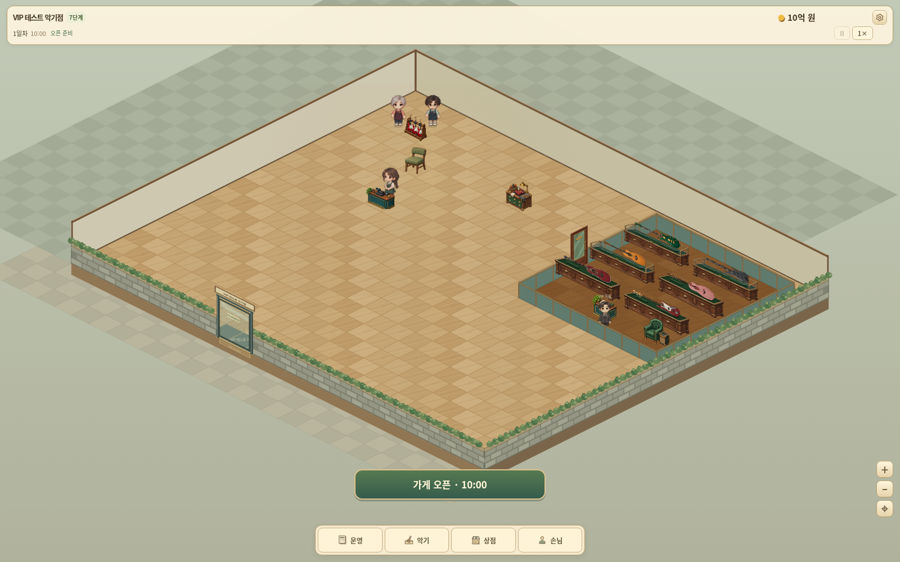

# 작은 선율 v3.20.0

**[일반 게임 ZIP 다운로드](https://github.com/dkmoon26-cmyk/test/raw/refs/heads/downloads/little-tone-v3.20.0/little-tone-v3.20.0-web.zip)**

**[7단계 · 10억 원 VIP 테스트판 다운로드](https://github.com/dkmoon26-cmyk/test/raw/refs/heads/downloads/little-tone-v3.20.0/little-tone-v3.20.0-test-stage7-1b.zip)**

- 등급: 입문급 → 일반급 → 전문급 → 고급 → 최고급 → 명품. 최고급·명품은 VIP 전용입니다.
- 시더 그랜드 어쿠스틱은 5단계, 문라이트 어쿠스틱은 6단계부터 판매합니다. 7단계·제작대 3등급에서 두 악기를 커스텀 제작할 수 있습니다.
- VIP 6명, 정장 차림 전용 직원, 8×8 VIP 구역. 직원 채용이 VIP 영업 조건에 포함됩니다.
- **진열대마다 악기 1개를 가로로 눕혀 전시합니다.** 최고급·명품용과 커스텀용 진열대를 구분합니다.
- 모든 단계 매장 확대, 일반 손님의 휴식 의자와 VIP 시연석 착석을 추가했습니다.

## 실제 게임 화면

[어쿠스틱 커스텀](./ui-v3.20.0-workshop-mobile.png) · [VIP 직원](./ui-v3.20.0-staff-mobile.png) · [VIP 고객](./ui-v3.20.0-vip-mobile.png) · [손님 휴식](./ui-v3.20.0-rest.png)

화면은 자금과 해금 조건을 지급한 테스트판에서 촬영했습니다.

## 실행·테스트

ZIP을 풀고 정적 웹 호스팅에 폴더 내용을 올리면 실행할 수 있습니다. 테스트판은 타이틀의 이어하기로 7단계·10억 원·제작대 3등급·VIP 직원·가로 진열대 6개가 준비된 매장을 시작합니다. 새로 시작하면 같은 테스트 조건으로 초기화됩니다. 일반판과 테스트판은 자동 저장 공간을 분리했습니다.

일반판에서도 [테스트 저장 파일](./test-save-stage7-1b-v3.20.0.json)을 저장 관리에서 불러올 수 있습니다.

기능 검사 644개, 경계 조건 검사 388개, 기존 회귀 검사 54개, 기존 운영 99일과 VIP 운영 18일을 검증했습니다. 새 어쿠스틱 옵션 34가지의 화면 반영, VIP 문 4방향, 판매 중 저장 복원, 실제 지도 클릭과 모바일 화면을 확인했습니다. 후반/VIP 검증은 자금·해금 조건을 지급한 테스트 매장 기준이며 실제 휴대전화 성능 테스트는 포함하지 않습니다.

[패치 내용과 저장 변환 안내](./PATCH-v3.20.0.md) · [검증 결과](./VALIDATION-v3.20.0.json) · [파일 SHA-256](./SHA256SUMS)

기존 저장을 백업한 뒤 업데이트하세요. 기존 VIP 구역은 보존되며, 8×8로 넓히고 최고급·명품 진열대 및 VIP 직원을 준비해야 VIP 영업을 재개할 수 있습니다. 기존 작은 커스텀 진열대는 재배치하면 새 3칸 가로 크기를 적용합니다. 저장 버전 24는 이전 게임 버전에서 읽을 수 없습니다.
