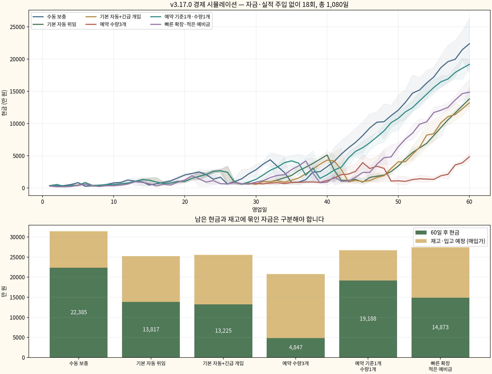

# v3.17.0 경제 시뮬레이션

시작 자금500만 원에서 자금·판매 실적·미션 진행을 주입하지 않고 6가지 운영 정책을 각3개 난수 시드로60일씩 실행했습니다. 총18회·1,080일입니다. 게임 파일은 변경하지 않았습니다.

## 60일 후 결과

금액은 정책별3회 평균입니다. 재고는 매장 재고와 입고 예정 물량의 매입가이며, 현금과 구분합니다.

| 운영 방식 | 최종 현금 | 재고·입고 예정 | 6단계 도달 |
|---|---:|---:|---|
| 수동 보충 | 2.24억 원 | 0.90억 원 | 33~35일 |
| 기본 자동 위임 | 1.38억 원 | 1.14억 원 | 41~42일 |
| 기본 자동+긴급 개입 | 1.32억 원 | 1.23억 원 | 41~43일 |
| 예약 수량3개 | 0.48억 원 | 1.59억 원 | 46~49일 |
| 예약 기준1개·수량1개 | 1.92억 원 | 0.75억 원 | 36~39일 |
| 빠른 확장·적은 예비금 | 1.49억 원 | 1.26억 원 | 38~39일 |

## 확인한 점

### 후반에는 돈이 빠르게 쌓입니다

기본 자동 정책의 마지막10일 평균은 하루 매출 약3,500만 원, 상품 원가·임대료·일급 등을 뺀 영업잉여 약955만 원입니다. 이때 임대료와 전체 직원 일급은 하루40만 원입니다. 후반에는 고정비 부담이 작습니다. 단, 영업잉여는 재고 매입과 확장·가구·고용비를 모두 지출한 뒤의 현금 수지와 다릅니다.

초반 운영비를 일괄 올리기보다 후반 수익과 자금 사용처를 점검할 필요가 있습니다. 이번 결과만으로 구체적인 가격 인상률을 확정할 수는 없습니다.

### 예약 수량을 전부3개로 늘리는 것은 비효율적이었습니다

기준 재고3개를 유지한 채 주문량을1개에서3개로 늘리면, 고가 악기 재고에 자금이 더 묶였습니다. 기본 자동 대비60일 후 재고 자금이 평균 약4,475만 원 많았고, 6단계 도달도 늦었습니다. 남은 현금이 적다고 그 차이 전부가 손실인 것은 아닙니다. 일부는 재고 자산이며, 일부는 늦어진 확장의 기회비용입니다.

수량1개를 유지한 현재 선택은 타당합니다. 현재의 '3개 이하일 때1개 주문'은 재고를1개만 보유하는 뜻은 아닙니다. 판매가 적은 품목은 결국3~4개 수준으로 채워집니다.

### 고가 상품의 주문 기준을 낮추는 방식은 개선 후보입니다

예약 상품의 수량은1개로 유지하고 기준만1개 이하로 바꾼 정책은 기본 자동 대비 다음과 같았습니다.

- 최종 현금 평균 약5,371만 원 증가.
- 재고·입고 예정에 묶인 자금 평균 약3,918만 원 감소.
- 6단계 도달 평균 약4일 단축.
- 품절 상태를 경험한 뒤 구매 없이 퇴장한 손님은60일 평균 약10명에서15명으로 증가.

기본 상품은 기존 설정을 유지했으며 예약 상품만 조정했습니다. 기준1개가 모든 상품에 정답이라는 뜻은 아닙니다. 소수 시드에서 얻은 결과이고 품절과의 교환 관계가 있습니다. 실제 게임 설정은 변경하지 않았습니다.

### 수동 운영의 높은 현금에는 많은 개입이 필요했습니다

수동 정책은10시뮬레이션초마다 재고를 확인합니다.60일 평균 수동 발주 횟수는 약1,114회, 기본 자동은 약101회입니다. 수동 정책은 매우 부지런한 봇으로, 일반 플레이어의 평균 성과를 나타내지 않습니다. 자동화의 편의성을 무시하고 현금만 비교해서는 안 됩니다.

### 긴급주문은 보조 수단으로 유효했습니다

기본 자동+긴급 개입은 예약 상품이 품절되면1개씩 긴급주문합니다.60일 평균 추가 수수료는365만 원이었고, 품절 미구매 퇴장은 기본 자동의 약10명에서8명으로 줄었습니다. 최종 현금 개선은 일관되지 않았습니다. 일상적인 대량 보충보다 급한 상황의 보조 수단으로 보는 편이 맞습니다.

### 빠른 확장에는 유동성 위험이 있습니다

이번 정책들에서는 마이너스 현금과 판매0인 영업일이 없었습니다. 다만 빠른 확장 정책에서는 관측 최저 현금이4만2,500원까지 내려갔고, 품절 미구매 퇴장이60일 평균 약51명으로 증가했습니다. 운영비 보호로 일부 상품의 직원 주문이 보류되는 구간도 길었습니다. 이것을 모든 자동 주문이 멈췄다는 뜻으로 해석하면 안 됩니다.

## 조건과 한계

- 난수 시드17/2026/731, 하루120시뮬레이션초, 업데이트0.1초. 그래픽은 미리 읽었지만 경제 상태에는 영향을 주지 않았습니다.
- 모든 구매·배치·확장·고용·미션 보상·이야기 선물은 게임의 정상 함수를 사용합니다. 모델에서 돈·재고·판매 실적을 직접 바꾸지 않습니다.
- 기본 재고9대는 게임이 제공하는 초기 자산입니다. 매입가 가치는216만 원이며 재고 장부 검증에서 이를 반영했습니다.
- 정상 획득한 미션 보상은 허용합니다. 광고, 카탈로그, 앰프·화분·포스터·러그는 사용하지 않았습니다. 기본 시연석과 해금된 전자드럼 시연 공간은 구입할 수 있습니다.
- 수동 보충은 재고 알바를 고용하지 않습니다. 모든 정책은 계산 대기가 늘면 자금 조건을 만족할 때 계산 직원을 고용합니다.
- 신중한 정책은10일 운영비를 바탕으로 예비금을 두고, 재고 알바가 있으면 기본 발주 한 묶음의 여유도 고려합니다. 빠른 확장은 예비금을 줄이고 고용/확장을 앞당깁니다. 따라서 전략 전체 비교이며 인건비만 분리한 단일 요인 A/B실험은 아닙니다.
- 기본 악기는 목표6개, 소모품5개, 직원이 담당하지 못하는 예약 상품은 목표3개로 수동 보충합니다. 직원 담당 상품은 해당 정책에 위임합니다. 첫 슬롯 재고 알바는 기본 상품, 두 번째는 예약 상품까지 담당합니다.
- 고가 상품을 포함해 해금된 상품을 점차 진열하는 플레이입니다. 실제 사용자처럼 특정 인기 상품만 골라 판매하는 최적화는 하지 않았습니다.
- 품절 미구매 퇴장 수는 재고가 있었다면 반드시 구매했을 손님 수가 아닙니다.
- 현금 수지는 재고·확장·가구·고용 지출을 포함합니다. 영업잉여는 판매된 상품의 현재 매입 원가·임대료·전체 일급·긴급 수수료·이야기 선물 원가를 차감하고 자본 지출은 제외합니다. 선택 할인 장식이 없어 매입 원가가 일정합니다.
- 정책별3개 시드는 플레이어 모집단이나 통계적 보장을 의미하지 않습니다.

## 장부 및 실행 검증

18회 모두 다음 항등식의 차이가0원이었습니다.

- 최종 현금 = 시작 현금 + 매출 + 정상 미션 보상 − 실제 현금 지출.
- 최종 현금+재고 = 시작 현금+초기 재고 가치 + 누적 영업잉여+미션 보상 − 확장·가구·고용 지출.

음수 재고, 현금/판매 장부 불일치, 실행 오류, 마감 중단은 관측되지 않았습니다. 배포 매니페스트와 대조해 게임 파일이 그대로임을 확인했습니다. 개점 순간의 자동 발주는 업데이트 샘플링 바깥에 있으므로 자동 매입비는 전체 현금 장부로 보정했으며 불완전한 자동 발주 횟수는 결론에 사용하지 않았습니다.

## 자료

- [요약 수치와 감사 결과](./summary.json)
- [영업일별 CSV](./daily.csv)
- [18회 전체 감사 데이터](./audited-runs.json)
- [시뮬레이션 정책 코드](./model.js)
- [실행 코드](./run.cjs) · [집계 및 그래프 코드](./analyze.py)

검증 코드는 현재 클라우드 환경의 게임/Playwright 경로를 사용합니다. 게임 배포 ZIP에 포함하지 않았습니다. 게임 패치는 하지 않았습니다.
