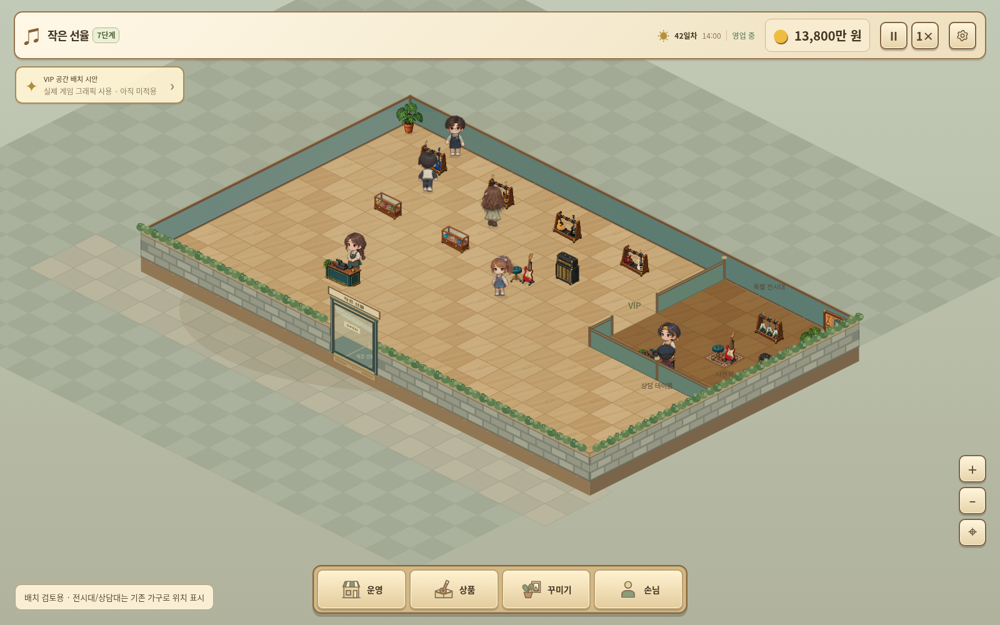
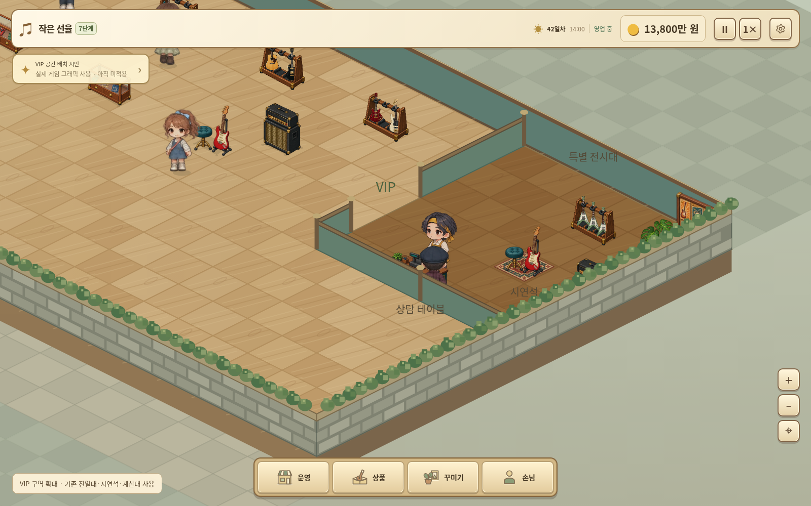

# 실제 게임 그래픽으로 만든 VIP 공간 배치 시안

v3.17.0의 실제 브라우저 렌더러와 배포된 바닥·가구·캐릭터 이미지를 사용했습니다.

- 오른쪽 6×6 공간을 VIP 구역으로 제안합니다.
- 기존 매장과 연결된 내부 입구, 낮은 칸막이, 바닥 색상 차이로 공간을 구분했습니다.
- 전용 가구는 아직 없으므로 기존 악기 진열대·시연석·계산대로 전시·시연·상담 위치를 표시했습니다.
- 7단계 표시, 매장 확장, 칸막이 및 손님 배치는 시안용 임시 브라우저 설정입니다. 방문·구매·제작 기능이 구현되었다는 의미는 아닙니다.
- 게임 배포 파일은 수정하지 않았으며 게임 패치가 아닙니다.

브라우저 캡처 중 실행 오류 없음. 캡처 조건은 [capture metadata](vip-actual-capture.json)를 참고하세요.
