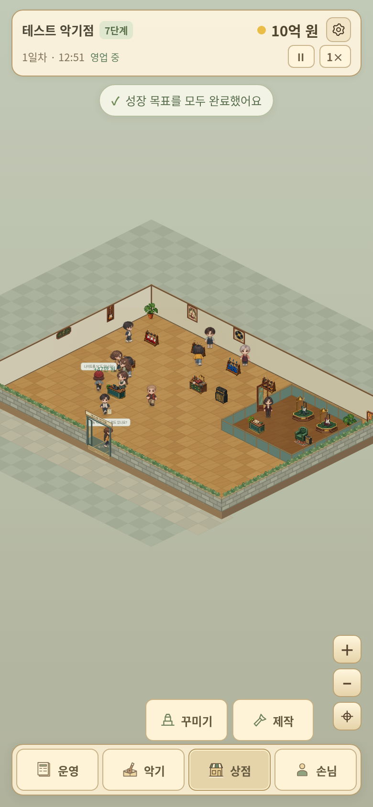

# 상단·하단 크기를 줄인 실제 게임 화면 시안

- 상단 높이 약 70px. 가게 이름·성장 단계·금액·날짜·시간·설정·일시정지·배속을 두 줄에 배치.
- 100,000만 원 대신 10억 원처럼 표시. 억·만·원 단위 정리. 금액을 누르면 원 단위 정확한 보유금을 작은 토스트로 확인하는 구성.
- 상시 성장 목표 완료 창 제거. 완료할 때 작은 토스트를 표시하고 3초 후 자동 숨김.
- 하단 메뉴와 펼침 버튼 높이 44px, 테두리 1px, 같은 색·모서리·아이콘 크기로 통일.
- 하단 전체 높이 약 54px, 메뉴 아이콘 18px. 꾸미기·제작 아이콘 17px.
- 제목과 바깥 배경이 없는 펼침 방식 유지. 운영·악기·손님도 동일한 버튼 규격.
- 광고 기능·운영 광고 항목·운영 VIP 공방 제거는 앞서 정리한 후속 패치 범위 유지.

320px·390px 화면에서 가로 넘침 없음, 버튼 높이와 테두리 규격, 3초 토스트 자동 숨김을 브라우저에서 확인했습니다.

기존 게임 이미지로 만든 브라우저 시안입니다. 배포 게임 파일과 ZIP은 아직 변경하지 않았습니다.
