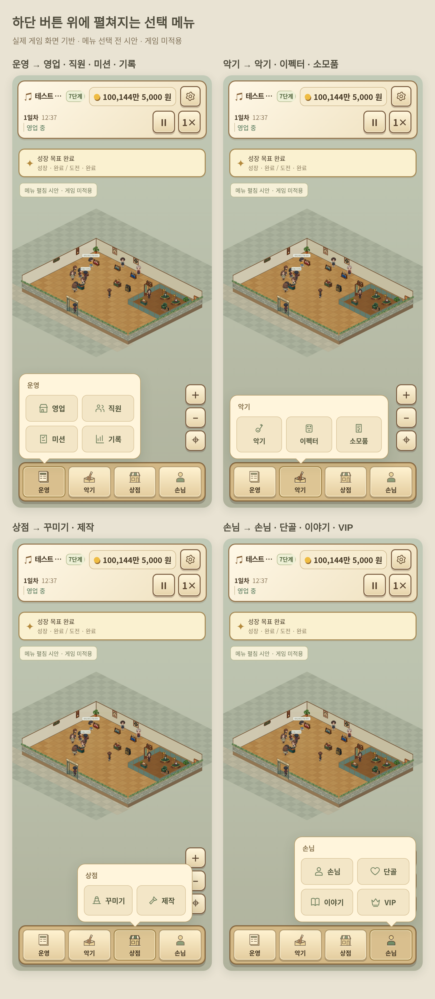

# 하단 버튼 위에 펼쳐지는 선택 메뉴 시안

실제 v3.18.0 게임 화면·캐릭터·가구 이미지를 사용했습니다.

| 하단 버튼 | 펼침 메뉴 | 확대 시안 |
|---|---|---|
| 운영 | 영업 · 직원 · 미션 · 기록 | [운영](operations.png) |
| 악기 | 악기 · 이펙터 · 소모품 | [악기](instruments.png) |
| 상점 | 꾸미기 · 제작 | [상점](store.png) |
| 손님 | 손님 · 단골 · 이야기 · VIP | [손님](guests.png) |

[VIP·커스텀 공방 영역을 제거한 운영 화면 시안](operations-content.png)

모든 하단 메뉴에서 해당 버튼 바로 위에 작은 선택 창을 띄우는 구성입니다. 선택하면 해당 관리 화면으로 이동하는 동작을 제안합니다.

시안용 브라우저 화면이며 배포 게임 파일은 수정하지 않았습니다. 손님 요청 삭제·커스텀 외형 수정 등의 게임 패치가 적용된 결과가 아닙니다.
