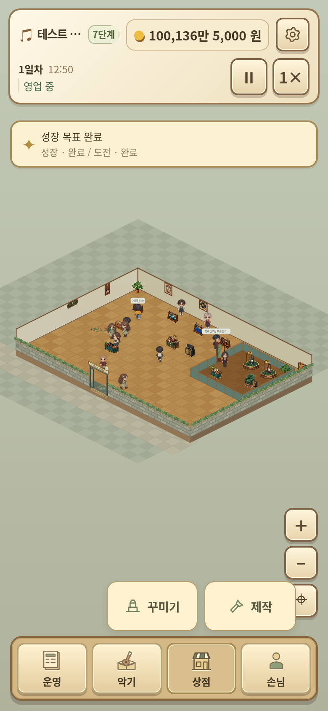

# 제목과 바깥 배경을 없앤 펼침 메뉴 시안

하단 상점을 누르면 바로 위에 꾸미기·제작 버튼만 표시합니다. ‘상점’ 제목, 메뉴를 감싸는 바깥 배경·테두리·화살표를 제거했습니다. 개별 선택 버튼의 배경과 테두리는 유지합니다.

운영(영업·직원·미션·기록), 악기(악기·이펙터·소모품), 손님(손님·단골·이야기·VIP)에도 같은 방식을 적용하는 시안입니다.

운영의 VIP·커스텀 공방 영역과 광고 항목은 시안에서 제거했습니다. 광고 기능 자체의 삭제도 후속 패치 범위에 포함합니다.

실제 게임 화면과 이미지를 사용한 브라우저 시안 한 장입니다. 배포 게임 파일은 아직 수정하지 않았습니다.
