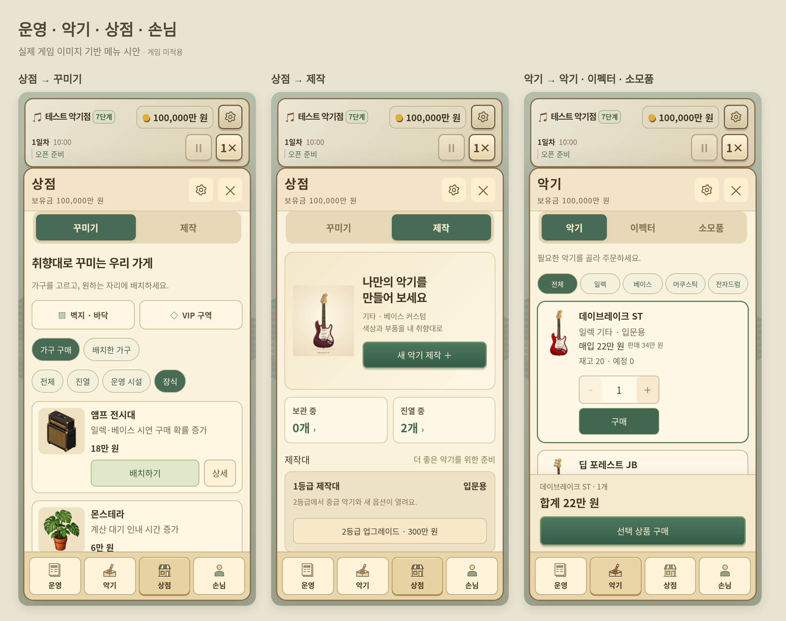

# 실제 게임 이미지 기반 메뉴 시안

하단: 운영 · 악기 · 상점 · 손님

- 상점 → 꾸미기 / 제작
- 악기 → 악기 / 이펙터 / 소모품
- 제작 탭에는 새 악기 제작, 보관·진열 수량, 제작대 업그레이드, 완성품 관리를 모았습니다.

[꾸미기 확대](decor.png) · [제작 확대](craft.png) · [악기 구매 확대](instruments.png)

v3.18.0의 실제 악기·가구 이미지와 브라우저 화면을 사용했습니다. 미리보기용 화면 구성이며, 옵션별 외형 반영 수정이나 게임 패치를 적용한 결과가 아닙니다. 배포 게임 파일과 ZIP은 변경하지 않았습니다.
